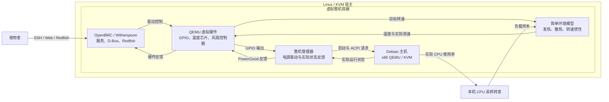

# OpenBMC 虚拟整机实验台

用一台普通的 Linux/KVM 机器，搭建一套由真实 OpenBMC 管理的虚拟服务器：能开关机、读取温度、控制风扇，并观察主机负载如何影响散热。

## 为什么做这个项目

学习 BMC 的第一道门槛往往是设备。开发板、配套主板和服务器带来采购、供电、噪声、空间及维护成本，让原本想了解服务器管理的人先面对一套硬件环境。

单独启动一个 OpenBMC 虚拟机虽然能看到界面和接口，却缺少被管理的主机：开机按钮到底启动了什么？关机请求有没有送达操作系统？温度升高后，风扇转速为什么变化？缺少这些对象，管理控制器的行为很难串起来理解。

本项目把被管理的主机也放进实验环境，让 OpenBMC 有一台真正运行操作系统的机器可以管理。电源、温度和风扇围绕这台主机形成反馈，把接口操作变成可以观察的整机行为。

## 解决了什么

| 入门时遇到的问题 | 实验台提供的方式 |
|---|---|
| 需要先购买和维护 BMC 配套硬件 | 使用 QEMU 运行 Witherspoon OpenBMC，使用 KVM 运行 Debian 主机 |
| BMC 界面里的电源操作缺少实际对象 | 将 BMC 电源输出连接主机生命周期，并反馈主机实际电源状态 |
| 难以区分关机请求和真正关机 | 通过 ACPI 请求 Debian 正常关机，观察客体退出、PowerGood 和机箱状态 |
| 温度和风扇读数缺少行为联系 | 用简单发热散热模型连接真实 CPU 使用率、虚拟温度器件和风扇测速 |
| 学习材料分散在驱动、D-Bus 和管理接口之间 | 在同一套环境里观察虚拟器件、Linux 驱动、OpenBMC 服务与 Redfish |

## 整体结构

一个 Docker 容器包装一台虚拟整机。容器内部，主机、BMC 和环境模型分别承担计算、管理和物理行为反馈。



主机关闭后 BMC 继续运行；BMC 独立重启时主机可以继续运行。整机管理器负责把 BMC 的电源意图落实到主机，并将实际结果送回虚拟硬件。

## 电源操作如何落到主机上

开机时，OpenBMC 按原生电源流程操作 GPIO，整机管理器读取输出并启动 Debian 虚拟机，再反馈 PowerGood。

正常关机时，BMC 的关机流程经整机管理器发送 ACPI 请求。Debian 停止服务、卸载文件系统并自行退出，随后电源反馈和机箱状态完成收尾。主机主动关机也会反馈到 BMC，之后可以再次开机。

这让学习者可以分别观察请求、过程和结果：Redfish 请求返回、BMC 服务执行、客体串口日志、主机退出以及最终机箱状态。

## 负载如何影响温度和风扇

Debian 的 CPU 使用率来自 `/proc/stat`。本机采样转发脚本通过 SSH 将样本送入环境模型，模型计算发热和散热，并更新 QEMU 温度芯片。OpenBMC 通过 Linux hwmon 驱动采集温度，再由 BMC 内的风扇控制程序决定目标转速。

风扇目标和实际测速分别保存。模型让实际转速逐渐追随目标，并用实际转速计算散热，形成下面的关系：

```text
CPU 负载增加 → 发热增加 → 温度上升 → BMC 提高风扇目标
     ↑                                      ↓
负载撤回后降温 ← 散热增强 ← 实际转速逐渐提高
```

环境模型采用少量变量和简单公式，用于展示控制关系。温度代表虚拟机箱的模型温度；风扇控制沿用 OpenBMC 原生程序，并为 x86 主机使用真实 PowerGood 作为温控启用条件。

一次完整的真实 CPU 实验包含 120 秒空闲、120 秒负载、120 秒撤载：CPU 平均使用率分别约为 0.17%、99.99% 和 0.18%；升载时风扇目标从约 5000 提高到 7200 RPM，撤载后温度回落、风扇逐步减速，最后 Debian 正常关闭。

## 从哪里开始

运行环境使用 Linux、Docker 和 KVM；主机虚拟机采用 x86 Debian，BMC 采用 AST2500 Witherspoon OpenBMC。基础容器资源配置为 4 CPU 配额、6 GiB 内存，管理端口绑定宿主回环地址，远程访问通过 SSH 隧道。

按用途进入对应文档：

| 想做什么 | 入口 |
|---|---|
| 准备独立 flash、主机磁盘并启动整机 | [独立整机部署](REPLAY.md) |
| 构建网页、登录 BMC 与重启后重新装载 | [Web UI](WEBUI.md) |
| 理解温度与风扇反馈的实现 | [热模型](THERMAL.md) |
| 构建和装载 x86 风扇控制策略 | [风扇策略](FAN-POLICY.md) |
| 采集实际 CPU 使用率并连接模型 | [实际负载接入](REAL-LOAD.md) |
| 启动一次完整的空闲、负载、降温实验 | `scripts/run-thermal-cycle.py --help` |

整机入口使用显式镜像标签和独立 `state` 目录。BMC flash、Debian overlay 和基础磁盘保留在该目录中；每个运行实例使用自己的可写磁盘。真实负载采样由本机脚本执行，风扇控制器由装载脚本放入 BMC 内存盘。

## 仓库里有什么

| 目录或文件 | 内容 |
|---|---|
| `src/lab_manager.py` | 主机与 BMC 生命周期、电源桥和反馈 |
| `src/thermal_model.py` | 发热、散热与风扇惯性模型 |
| `src/thermal_bridge.py` | 环境模型与 QEMU 虚拟器件的连接 |
| `patches/qemu/` | MAX31785 转速、寄存器及外部测速反馈补丁 |
| `patches/openbmc/` | 固件构建适配补丁 |
| `config/` | 固件来源、风扇配置与 BMC 服务定义 |
| `scripts/` | 构建、部署、采样与实验入口 |
| `tests/` | 生命周期、安装和热模型测试 |
| `Dockerfile*`、`compose*.yaml` | 分阶段构建与独立运行配置 |

## 许可证

本项目原创代码采用 [MIT License](LICENSE)。OpenBMC、QEMU 及其他第三方组件遵循各自许可证。
